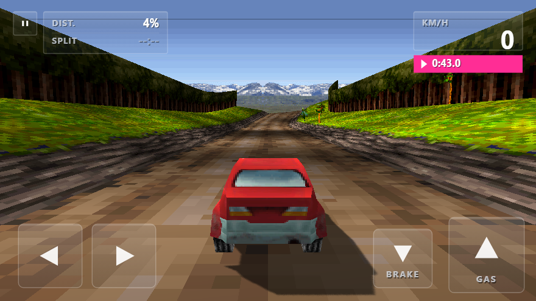

# Rally 3D — Landscape Edition (mobile first)

A **landscape rebuild** of the original Nokia Rally 3D (2005 J2ME), using the
real assets extracted from the original jar: the actual car model, textures,
sprite sheets, MIDI music, track data, UI text, medal times and unlock rules.
No Java, no emulation — JavaScript + Three.js, rebuilt for a 16:9 phone screen
with modern, thumb-friendly controls.

Everything in this folder is self-contained: the game, its assets and the
server it runs on.

## Where it came from

The original jar is `rally_3d_240x320-258294.jar` in the parent folder, next
to `extracted/` (the assets pulled out of it) and `tools/classdump.py` (a
small JVM class disassembler used to read the game's physics, camera and
unlock logic). The tracks, the suspension constants, the medal times and the
championship rules here are ports of what that disassembly showed.

## How to run

Double-click **`start.bat`** (Windows), or in a terminal in this folder:

    python3 serve.py 8089        (Windows: py serve.py 8089)

then open:

    http://localhost:8089/game/index.html

- **Why a server?** Opening `index.html` from the file system (`file://`) is
  blocked by the browser's WebGL texture security rules. Any static server
  works — the bundled `serve.py` is just the easiest.
- **On a phone**: serve the folder on your computer and open the address on
  the phone over Wi-Fi, or host the folder on any static host. The page is
  fully offline — Three.js, textures, models and music are all bundled.
- Save data (medals, unlocked cars/tracks, settings) persists in the browser's
  localStorage under its own key, so it does not clash with the portrait port.

## Controls (mobile)

Everything is done with **tap targets** — no soft keys, no keyboard.

| Where | Control | Action |
|-------|---------|--------|
| bottom left | ◀ ▶ | Steer (press and hold, slide between them) |
| bottom right | ▲ GAS | Accelerate (press and hold) |
| bottom right | ▼ BRAKE | Brake |
| top left | ‖ | Pause menu |
| menus | tap a row | Select / change a setting |
| menus | ◀ ▶ on the page | Previous / next page |

The pads are real *hold* areas, so steering and accelerating at the same time
works, and you can slide a thumb from ◀ to ▶ without lifting it.

**Tilt steering** (optional): Settings → *Tilt steering* → on. The neutral
angle is calibrated the moment you enable it, so hold the phone the way you
like to drive and it becomes straight. On iOS the browser asks for the motion
permission on that tap. Tilt and the on-screen pads can be used together.

The touch controls can be hidden entirely — from the pause menu
(‖ → *Settings* → *Touch controls*) or from the main Settings menu. Hide them
when you drive with tilt only, or when you want the screen clear for the
scenery.

## Gamepad

Plug one in and it just works — the game asks for the first pad it finds.

| Pad | Action |
|-----|--------|
| Left stick / d-pad | Steer |
| Right stick | Steer as well |
| Right trigger / A | Accelerate |
| Left trigger / B | Brake |
| Start | Pause menu |
| A / B | Select / back in the menus |
| X | Switch camera |
| d-pad | Move through the menus |

## Graphics

Settings → *Graphics*, or the same three rows in the in-race pause menu.

| Option | What it does |
|--------|--------------|
| **Motion blur** | A radial blur that grows with your speed. Only the far edges of the screen smear — the car and the road ahead stay sharp, so it reads as speed rather than as a smudge. |
| **Camera shake** | The whole frame — scenery, car and HUD together — rattles by a pixel or two, more at speed and rougher where the suspension is working. Because everything moves together it never reads as the car wobbling on its own. Can be switched off entirely. |
| **Lighting** | Puts a sun on the track: the slopes that face the light are brighter, the ones turned away are darker, and the car picks up the same light. |
| **Shadows** | A real shadow map. The car casts a shadow onto the road that moves with it; the shadow box follows the car, so the map only ever has to cover the road around you. |

The background panoramas are mirrored into a double-width strip so they tile
without a seam — a hard vertical line that moves with the camera is very
noticeable, and it was what made the view look broken.

Changing a setting rebuilds what it affects on the spot — no restart, and the
race carries on.

## Modes

*New game* offers three ways to play:

- **Championship** — the twelve races in order, with the medal rules of the
  original. It goes straight to the track list.
- **Time trial** — one track against the clock.
- **Multiplayer** — the same track list, but the race has an AI opponent
  driving the racing line beside you. The HUD shows your position
  (`POS. 1/2`); the opponent slows for the corners, so it can be caught.

## Cameras

Four viewpoints, switched with the **C** key (during a race or from the pause
menu) or from *Pause → Settings → Camera*. The choice is remembered.

| Camera | What you see |
|--------|--------------|
| **Chase** | The default: behind and above the car, with the original's trailing yaw so the car leads the camera into a corner. |
| **Hood** | Just behind the front bumper, below the line of the bonnet: the nose fills the bottom of the frame, the road runs right up to it and the front wheels never appear. |
| **Bumper** | Ahead of the nose, at bumper height. The fastest, most committed view. |
| **Top down** | From above, the nose pointing up the screen — the rally driver's view of a corner entry. |

The hood and bumper cameras are placed from the shape of the car being driven,
so they fit all four models, and they are bolted to the car: no vertical lag,
and they are lifted if the road rises above them, so a crest or a jump can
never swallow the view. The background scenery is pinned to the horizon of
whichever camera is active, so the sky and the distant hills always line up.
When you cross the finish line the camera always drops back to the chase view
for the run out.

Keyboard still works for desktop testing: arrows / WASD, Enter = OK,
Esc = back, P = pause.

## What's different from the portrait port

- **Landscape 16:9 frame** (640x360 logical) instead of 240x320. The canvas is
  scaled to the device and rendered at up to 2x device resolution, so text
  stays crisp on a phone.
- **A race-timing interface**: translucent grey plates with thin white rules,
  uppercase technical labels and values in a bright accent. The race HUD puts
  a pause box and a `DIST. / SPLIT` data panel in the top left and the speed
  box in the top right with the clock on a magenta strip underneath. The menus
  follow the same language: a slim checkered rule under the header, menu rows
  as ruled plates, the track list as a 4x3 grid of track cards with medal cups
  and padlocks, and the game's own scenery pushed back behind them.
- **Touch-first input**: press-and-hold pads, tap-to-confirm, multi-touch, and
  a portrait "rotate your device" hint on phones. Every tap answers with a
  short flash so the screen never feels dead.
- **Four cameras** — chase, hood, bumper and top-down — switched with the C
  key or from the pause menu.
- **Screen changes**: a shutter closes over the scene, the screen swaps at
  full cover and the shutter opens again, while the scene itself drifts a few
  pixels. 180 ms in, 220 ms out — enough to follow, quick enough to feel
  like a switch.
- **Camera**: re-framed for the wide screen — the same 60 degree vertical lens
  and the original's 9-unit chase distance keep the world at exactly the
  original's pixel scale, so the track reads the same, only wider. The camera
  is pitched down 7.5 degrees so the car sits in the lower third and more of
  the road ahead is visible.

Everything else is unchanged: the 12 tracks are rebuilt 1:1 from the original
turtle-graphics data, the suspension/steering/off-road constants come from the
decompiled jar, medals, unlock rules and the championship are the original's,
and the music is the original MIDI played through the same General-MIDI
synthesizer (TinySoundFont / TinySynth) as the portrait port.

## What's inside

- `game/` — the whole game as static files:
  - `index.html` — the landscape shell (viewport, fullscreen, rotate hint)
  - `js/` — three.min.js (Three.js r128), engine.js (track mesh generator
    ported 1:1 from the original renderer), race.js (physics/camera/HUD),
    scenes.js (menus/showroom), main.js (viewport, UI toolkit, input,
    audio, saves), data.js (track geometry, sprite sheets, language strings)
  - `assets/` — the 46 original PNGs and the 5 original MIDI music files
- `serve.py` — static file server (Range-capable, stdlib only)
- `start.bat` / `start.sh` — one-click launchers
- `docs/screenshots/` — reference frames of the finished interface
- `tools/shotserver.py` — dev server that also accepts `POST /shot` and writes
  the posted PNG to `shots/` (used to inspect rendered frames)
- `tools/shot.js` — dev tool that drives headless Chrome to the DevTools
  protocol and screenshots the game in any state
- `game/_shot.html` — the harness page `shot.js` drives (not part of the game)

## Known notes

- The first play loads the General-MIDI soundfont, which takes a few seconds
  on a slow device — the title screen appears after that.
- Audio starts after the first tap (browser autoplay policy), which is also
  when the touch pads become live.
