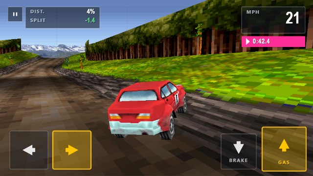

# Rally 3D — Landscape Edition (mobile first)

A **landscape rebuild** of the original Nokia Rally 3D (2005 J2ME), using the
real assets extracted from the original jar: the actual car model, textures,
sprite sheets, MIDI music, track data, UI text, medal times and unlock rules.
No Java, no emulation — JavaScript + Three.js, rebuilt for a 16:9 phone screen
with modern, thumb-friendly controls.

Everything in this folder is self-contained: the game, its assets and the
server it runs on.

## Where it came from

The original jar is `rally_3d_240x320-258294.jar` in the parent folder, next
to `extracted/` (the assets pulled out of it) and `tools/classdump.py` (a
small JVM class disassembler used to read the game's physics, camera and
unlock logic). The tracks, the suspension constants, the medal times and the
championship rules here are ports of what that disassembly showed.

## How to run

Double-click **`start.bat`** (Windows), or in a terminal in this folder:

    python3 serve.py 8089        (Windows: py serve.py 8089)

then open:

    http://localhost:8089/game/index.html

- **Why a server?** Opening `index.html` from the file system (`file://`) is
  blocked by the browser's WebGL texture security rules. Any static server
  works — the bundled `serve.py` is just the easiest.
- **On a phone**: serve the folder on your computer and open the address on
  the phone over Wi-Fi, or host the folder on any static host. The page is
  fully offline — Three.js, textures, models and music are all bundled.
- Save data (medals, unlocked cars/tracks, settings) persists in the browser's
  localStorage under its own key, so it does not clash with the portrait port.

## Controls (mobile)

Everything is done with **tap targets** — no soft keys, no keyboard.

| Where | Control | Action |
|-------|---------|--------|
| bottom left | ◀ ▶ | Steer (press and hold, slide between them) |
| bottom right | ▲ GAS | Accelerate (press and hold) |
| bottom right | ▼ BRAKE | Brake |
| top right | ⏸ | Pause menu |
| menus | tap a row | Select / change a setting |
| menus | ◀ ▶ on the page | Previous / next page |

The pads are real *hold* areas, so steering and accelerating at the same time
works, and you can slide a thumb from ◀ to ▶ without lifting it.

**Tilt steering** (optional): Settings → *Tilt steering* → on. The neutral
angle is calibrated the moment you enable it, so hold the phone the way you
like to drive and it becomes straight. On iOS the browser asks for the motion
permission on that tap. Tilt and the on-screen pads can be used together.

The steering pads can be hidden entirely (Settings → *On-screen buttons* →
off) if you drive with tilt only.

Keyboard still works for desktop testing: arrows / WASD, Enter = OK,
Esc = back, P = pause.

## What's different from the portrait port

- **Landscape 16:9 frame** (640x360 logical) instead of 240x320. The canvas is
  scaled to the device and rendered at up to 2x device resolution, so text
  stays crisp on a phone.
- **A race-timing interface**: translucent grey plates with thin white rules,
  uppercase technical labels and values in a bright accent. The race HUD puts
  a pause box and a `DIST. / SPLIT` data panel in the top left and the speed
  box in the top right with the clock on a magenta strip underneath. The menus
  follow the same language: a slim checkered rule under the header, menu rows
  as ruled plates, the track list as a 4x3 grid of track cards with medal cups
  and padlocks.
- **Touch-first input**: press-and-hold pads, tap-to-confirm, multi-touch, and
  a portrait "rotate your device" hint on phones. Every tap answers with a
  short flash so the screen never feels dead.
- **Crisp screen changes**: a hard vertical wipe with a hot amber edge (100 ms
  out, 120 ms in) instead of the portrait build's sliding checkered banner.
- **Camera**: re-framed for the wide screen — the same 60 degree vertical lens
  and the original's 9-unit chase distance keep the world at exactly the
  original's pixel scale, so the track reads the same, only wider. The camera
  is pitched down 7.5 degrees so the car sits in the lower third and more of
  the road ahead is visible.

Everything else is unchanged: the 12 tracks are rebuilt 1:1 from the original
turtle-graphics data, the suspension/steering/off-road constants come from the
decompiled jar, medals, unlock rules and the championship are the original's,
and the music is the original MIDI played through the same General-MIDI
synthesizer (TinySoundFont / TinySynth) as the portrait port.

## What's inside

- `game/` — the whole game as static files:
  - `index.html` — the landscape shell (viewport, fullscreen, rotate hint)
  - `js/` — three.min.js (Three.js r128), engine.js (track mesh generator
    ported 1:1 from the original renderer), race.js (physics/camera/HUD),
    scenes.js (menus/showroom), main.js (viewport, UI toolkit, input,
    audio, saves), data.js (track geometry, sprite sheets, language strings)
  - `assets/` — the 46 original PNGs and the 5 original MIDI music files
- `serve.py` — static file server (Range-capable, stdlib only)
- `start.bat` / `start.sh` — one-click launchers
- `docs/screenshots/` — reference frames of the finished interface
- `tools/shotserver.py` — dev server that also accepts `POST /shot` and writes
  the posted PNG to `shots/` (used to inspect rendered frames)

## Known notes

- The first play loads the General-MIDI soundfont, which takes a few seconds
  on a slow device — the title screen appears after that.
- Audio starts after the first tap (browser autoplay policy), which is also
  when the touch pads become live.
